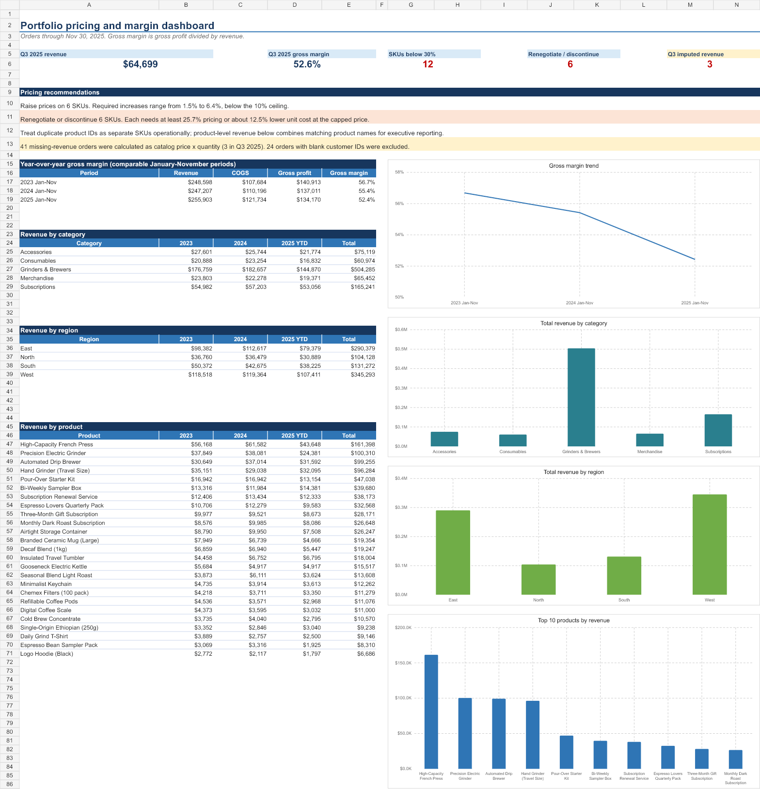
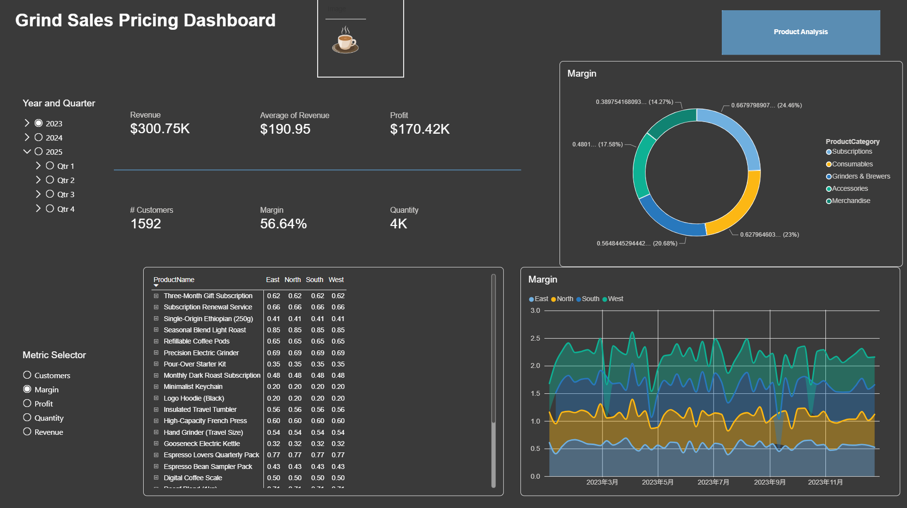
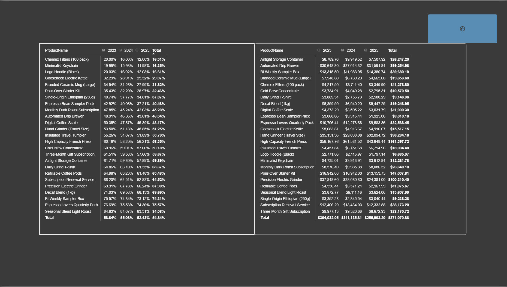

# Three-Year Gross Margin and Pricing Strategy Analysis

An end-to-end retail pricing analysis of 2023–2025 order data, built to identify margin deterioration, isolate Q3 2025 products below a 30% gross-margin threshold, and recommend targeted price increases, supplier renegotiation, or discontinuation.

## Business problem

Management observed a significant decline in gross profit margin across the product portfolio. Rising cost of goods sold (COGS), including potential tariff pressure, was identified as the primary concern.

The analysis was designed to answer four questions:

1. How did gross margin change from 2023 through 2025?
2. Which products fell below a 30% gross margin in Q3 2025?
3. Which products can recover the target margin through a reasonable price increase?
4. Which products require cost renegotiation or possible discontinuation?

## Data and methodology

The source data contains 4,456 order rows across five CSV files:

- Annual order files for 2023, 2024, and 2025
- A customer lookup containing region and customer join date
- A product lookup containing product name, category, catalog price, and base cost

The SQL workflow standardizes order dates, converts blank revenue values to `NULL`, combines the annual order tables, and joins customer and product attributes. Missing revenue is imputed as catalog price multiplied by quantity. Gross profit and gross margin are calculated as:

```text
Gross profit = Revenue - COGS
Gross margin = Gross profit / Revenue
```

For a comparable year-over-year view, the dashboard compares January–November for each year. The pricing action analysis uses Q3 2025 orders and applies two management rules: a 30% minimum gross margin and a maximum one-step price increase of 10%.

### Vibe Analytics workflow

I used **Vibe Analytics**, an AI-assisted analysis workflow, to accelerate the Excel dashboard build, organize the pricing logic, and surface exceptions. I then validated the headline metrics and recommendation rules against the source data and workbook calculations. The final deliverable combines SQL-based data preparation, Power BI exploration, and an executive Excel dashboard.

## Analysis results

### Gross margin declined while revenue increased

| Comparable period | Revenue | COGS | Gross profit | Gross margin |
| --- | ---: | ---: | ---: | ---: |
| 2023 Jan–Nov | $248,598 | $107,684 | $140,913 | 56.7% |
| 2024 Jan–Nov | $247,207 | $110,196 | $137,011 | 55.4% |
| 2025 Jan–Nov | $255,903 | $121,734 | $134,170 | 52.4% |

From 2024 to 2025, revenue increased 3.5%, but COGS increased 10.5%. Gross profit decreased 2.1%, and gross margin fell 3.0 percentage points. Compared with 2023, the 2025 gross margin was 4.3 percentage points lower. The result supports management's concern: higher sales did not translate into higher gross profit because costs rose faster than revenue.

### Q3 2025 pricing review

Q3 2025 generated **$64,699 in revenue** at a **52.6% portfolio gross margin**. Twelve SKUs fell below the 30% target. Duplicate product IDs mean those 12 SKUs represent six product names.

| Product | Category | Q3 gross margin | Current price | Minimum target price | Required increase | Recommendation |
| --- | --- | ---: | ---: | ---: | ---: | --- |
| Minimalist Keychain | Merchandise | 12.0% | $27.37 | $34.42 | 25.8% | Renegotiate cost or discontinue |
| Logo Hoodie (Black) | Merchandise | 12.0% | $15.23 | $19.15 | 25.7% | Renegotiate cost or discontinue |
| Chemex Filters (100 pack) | Accessories | 12.0% | $24.10 | $30.30 | 25.7% | Renegotiate cost or discontinue |
| Gooseneck Electric Kettle | Accessories | 25.5% | $34.87 | $37.10 | 6.4% | Raise price to target |
| Branded Ceramic Mug (Large) | Merchandise | 28.0% | $43.20 | $44.45 | 2.9% | Raise price to target |
| Pour-Over Starter Kit | Grinders & Brewers | 29.0% | $105.23 | $106.78 | 1.5% | Raise price to target |

The three viable price actions stay below the 10% ceiling. The remaining three products require increases of at least 25.7%. At the capped price, they would need roughly a 12.5% reduction in unit cost to reach the target margin.

### Revenue concentration

- **Grinders & Brewers** generated $504,285, approximately 58% of total portfolio revenue.
- **West** was the largest region with $345,293, followed by **East** with $290,379.
- **High-Capacity French Press** was the highest-revenue product at $161,398.
- The largest revenue contributors are not the products driving the Q3 margin exception list, so targeted actions are preferable to a portfolio-wide price increase.

## Pricing recommendations

1. **Implement targeted increases on six SKUs.** Raise the Gooseneck Electric Kettle to $37.10, the Branded Ceramic Mug to $44.45, and the Pour-Over Starter Kit to $106.78. Duplicate product IDs should receive the same product-level action.
2. **Renegotiate costs for six structurally weak SKUs.** Prioritize the Minimalist Keychain, Logo Hoodie, and Chemex Filters. Seek at least a 12.5% unit-cost reduction if management retains the 10% pricing ceiling.
3. **Discontinue products when negotiations fail.** The three weakest products cannot reach a 30% margin through the permitted one-step price increase alone.
4. **Monitor margin monthly after implementation.** Track realized selling price, units, revenue, COGS, and gross margin by SKU to confirm that the intervention improves profit without creating an unacceptable volume decline.
5. **Protect high-revenue categories.** Test pricing carefully in Grinders & Brewers because it represents most portfolio revenue. Avoid broad increases without elasticity evidence.

## Dashboard views

### Excel pricing strategy dashboard



### Power BI portfolio overview



### Power BI product analysis



## Next steps and limitations

- The data shows correlation between higher COGS and lower margin, but it does not isolate tariffs from freight, supplier pricing, discounts, or other cost drivers.
- The recommendations do not yet model demand elasticity, competitor prices, inventory levels, or customer churn. Pilot the increases before a full rollout.
- Forty-one missing-revenue orders were imputed using catalog price multiplied by quantity, including three orders in Q3 2025.
- Twenty-four orders with blank customer IDs were excluded from the analytical dashboard.
- Duplicate product IDs were treated as separate SKUs for operational recommendations and combined by product name for executive revenue reporting.
- The 2025 year-over-year view covers January–November, while the pricing exception analysis covers Q3 2025.
- A future iteration should add supplier and tariff detail, promotional discounts, price-change dates, and post-intervention unit volume.

## Repository contents

| File | Description |
| --- | --- |
| [`Retail_Pricing_Strategy_Dashboard.xlsx`](Retail_Pricing_Strategy_Dashboard.xlsx) | AI-assisted Excel dashboard with executive KPIs, revenue views, and SKU-level pricing actions. |
| [`Portfolio Dashboard.pbix`](Portfolio%20Dashboard.pbix) | Interactive Power BI dashboard for portfolio and product exploration. |
| [`Data Transform.sql`](Data%20Transform.sql) | Audits missing revenue and standardizes revenue and date data types. |
| [`Data Preparation.sql`](Data%20Preparation.sql) | Combines annual orders, joins lookup tables, and creates the analysis-ready dataset. |
| `Orders_2023.csv`–`Orders_2025.csv` | Annual transaction data. |
| `customers.csv` | Customer region and join-date lookup. |
| `products.csv` | Product category, price, and base-cost lookup. |
| `assets/` | Dashboard images used in this README. |

## Tools

- MySQL and SQL
- Microsoft Power BI
- Microsoft Excel
- Vibe Analytics (Codex)
- Git and GitHub

